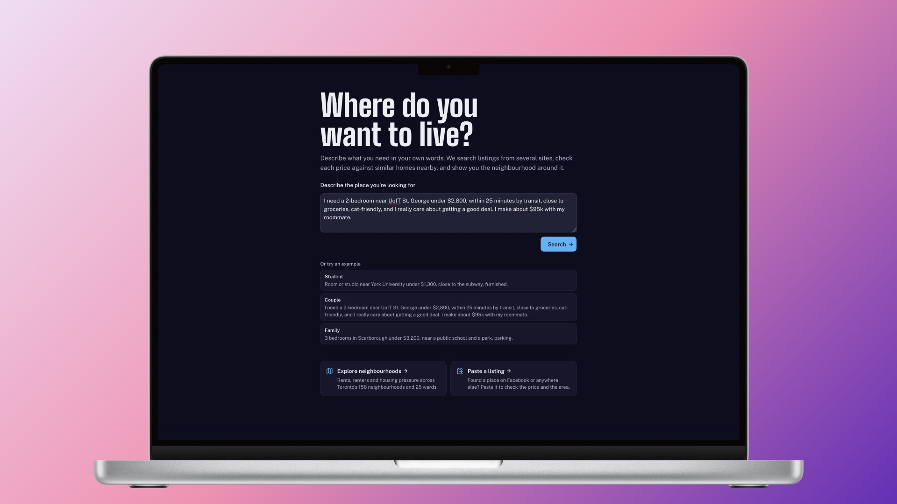
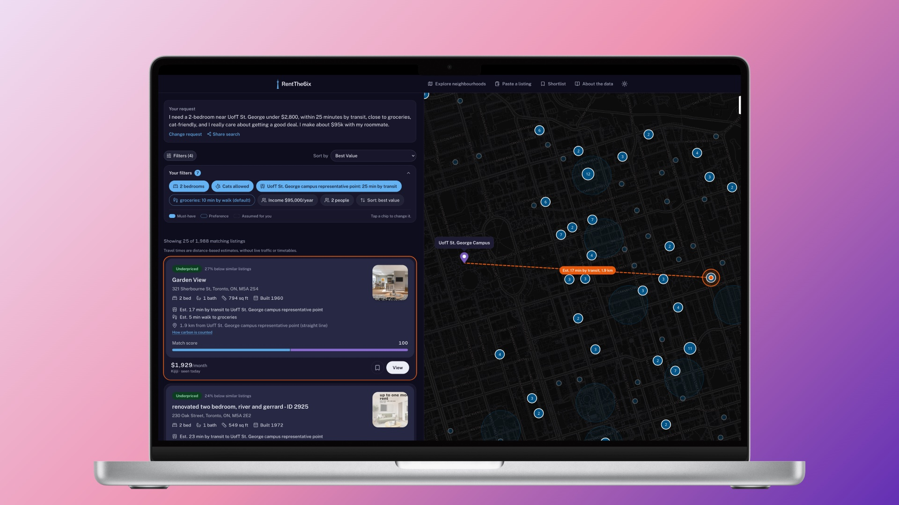
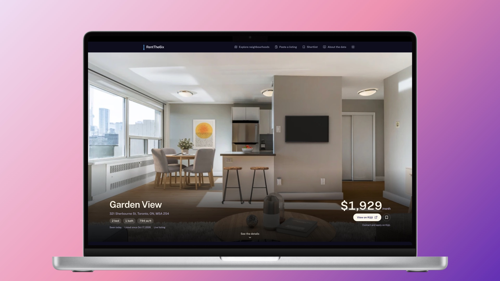
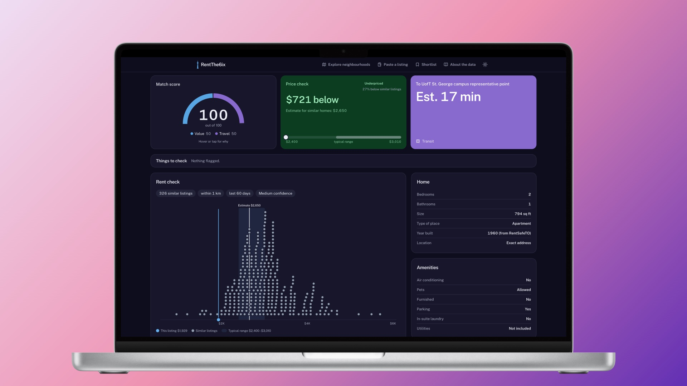

# RentThe6ix


**[▶ Watch the demo video](https://www.youtube.com/watch?v=CLQsM87pwk4)**

**Find the best-fit, best-value rental in Toronto, and see the neighbourhood around it.**

Describe what you need in plain English ("2-bed near UofT under $2,800, cat-friendly, 10 min walk to a supermarket, with AC"). RentThe6ix turns it into filters you can edit, searches listings gathered from several rental sites, and ranks them on price vs market, travel time (transit, car, walk or bike), the home itself, and, if you turn it on, neighbourhood crime rates. Every listing comes with its neighbourhood and ward context from Toronto open data: typical rents, how renters there are doing, transit, the building's RentSafeTO inspection score, and what's being built nearby.

Built at **Hack the Valley** for the Hack the Valley × School of Cities civic track, with the Gemini, Vultr and TigerData tracks.

> Status: completed. Live at [6ix.casa](https://6ix.casa).

## Screenshots

**Describe what you need in plain English**



**Ranked results on a map, with travel time to where you need to be**



**Every listing checked against similar homes nearby**

<p>
  
  
</p>

## How it works

- **Gemini** reads your request and turns it into structured filters, explains why a listing ranks where it does, reads listings you paste from Facebook groups, and writes neutral housing briefings for each ward. It never produces a number: every figure comes from the engine and the database.
- **PostgreSQL** with PostGIS and TimescaleDB stores listings, price history and Toronto civic data, and runs the spatial and comparable-rent queries. It ran on TigerData during the hackathon; we later moved it to a self-hosted PostgreSQL container on the same Vultr instance.
- **Vultr** hosts everything on one instance: the app, the database, and the worker that collects listings from rental sites every six hours.
- **Toronto open data** and Statistics Canada, CMHC, TTC and Toronto Police data give each listing its context. Full list with links and licences: the `/data` page and `SPEC.md` section 8.

## Repo layout

```
apps/web          Next.js app (UI + API routes)
apps/worker       listing collection, civic data loaders, travel-time precompute
packages/shared   zod schemas, fixtures, the pure TypeScript engine
db/migrations     SQL migrations (PostgreSQL + PostGIS + TimescaleDB)
db/seed           benchmarks, manual backup listings
otp/              OpenTripPlanner config (graph is built on the server, not committed)
```

## Running it locally

Requirements: Node 24 and pnpm 10 or newer.

The quickest way to look around: the app runs on built-in sample listings, with no database, AI key or map key needed.

```bash
pnpm install
pnpm dev                          # http://localhost:3000
```

Without keys it skips the AI features (`AI_PROVIDER=none`), uses the free OpenFreeMap basemap instead of MapTiler, and shows straight-line distances instead of transit times.

To run it on real data you also need a PostgreSQL database with PostGIS, TimescaleDB and pg_trgm (setup in `DEPLOY.md` section 1). Create a `.env.local` at the repo root with the variables listed in `SPEC.md` section 20, then:

```bash
pnpm db:migrate                   # create the tables
pnpm data:civic                   # load Toronto open data
pnpm ingest:once                  # collect listings from the rental sites once
pnpm dev
```

The web app, the worker and the scripts all read the same `.env.local`.

### Scripts

| Script | What it does |
| --- | --- |
| `pnpm dev` / `build` / `start` | run, build or serve the web app |
| `pnpm typecheck` / `lint` / `test` | check all packages |
| `pnpm format` / `format:check` | format the repo with Prettier |
| `pnpm db:migrate` | apply the SQL migrations in `db/migrations` |
| `pnpm data:civic` | load Toronto open data, points of interest, RentSafeTO, crime rates and rent benchmarks |
| `pnpm ingest:once` | run one round of listing collection |

## Project docs

The planning docs from the hackathon are kept in the repo for reference:

- `SPEC.md`: the full design: features, data sources and licences, ranking, environment variables
- `DEPLOY.md`: how it's deployed on Vultr with PostgreSQL and OpenTripPlanner
- `DEVPOST.md`: the Devpost submission
- `TEAM.md`, `PERSON_A.md` … `PERSON_D.md`, `PROGRESS.md`: how the four of us split up the work and tracked it during the hackathon

## Data and limits

Asking rents are not signed-lease rents. Travel times by car assume no traffic. Crime rates are neighbourhood averages of police-reported incidents and say nothing about a specific street, building or the people who live there. Listings link back to their original source; we don't store photos or contact details. See the `/data` page for every source, date and licence.
