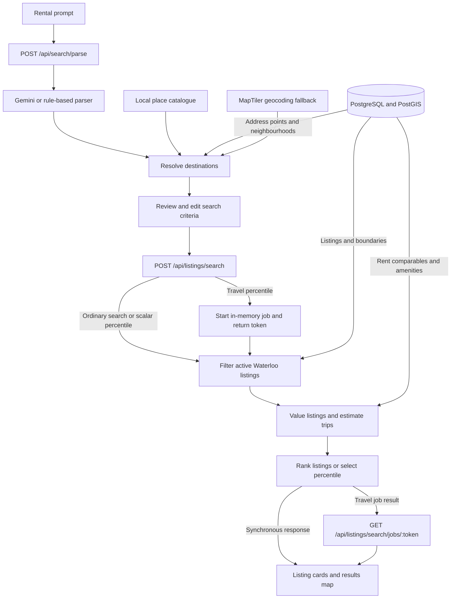

# Search and places

- The parser produces a structured `SearchIntent`. The browser can submit edited criteria directly to listing search and pause for a destination choice when a place is ambiguous. Waterloo landmarks and intersections resolve locally. Selected Kitchener places, including the GO station, can be commute destinations.
- Ordinary search returns up to 500 ranked listings. Percentiles use the full eligible pool. A travel percentile returns a job token for polling, and the job lives in the Next.js process that starts it.
- Search estimates commute times from straight-line distances and mode-specific assumptions. When configured, OpenTripPlanner serves map routes through `/api/route`. Waterloo neighbourhood crime scoring is disabled.

Source files include `apps/web/src/lib/parse/`, `apps/web/src/lib/api/runtime.ts`, `apps/web/src/lib/db/candidates.ts`, `apps/web/src/lib/db/candidates-percentiles.ts`, and `packages/shared/engine/`.

[Waterloo](Waterloo.md) · [Data imports](Data%20imports.md) · [Database](Database.md) · [Listing and area views](Listing%20and%20area%20views.md)
