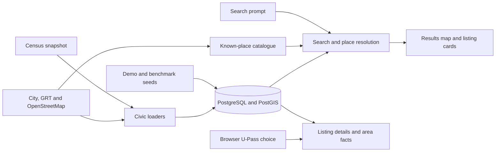

# Waterloo rental search

## PR objectives

- Make rental search Waterloo-first by limiting listings to the city and resolving local destinations, including key Kitchener commute points.
- Load GRT and ION stops, nearby amenities, census figures, and development applications. Disable neighbourhood crime scoring because the available data cannot support reliable district rates.
- Give renters local asking-rent benchmarks and a monthly cost estimate with a U-Pass option. Seed 25 labelled demo rentals for testing and walkthroughs.

## Architecture graph

Open this folder as an Obsidian vault and start here. Open **Local graph** at depth 2 to see the linked notes. The diagram below shows the direction of data flow.

- [Data imports](Data%20imports.md) records the upstream feeds and seeds.
- [Database](Database.md) shows how the data is stored and joined.
- [Search and places](Search%20and%20places.md) follows a prompt to a Waterloo result.
- [Listing and area views](Listing%20and%20area%20views.md) shows what renters see.
